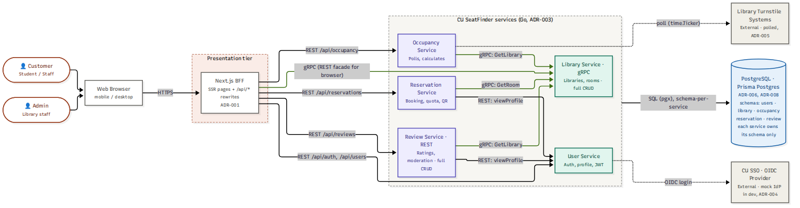

**Microservice architecture**

**Step 1 Identify system operations**

System operations are abstractions of external requests derived from the use cases (UC-01 to UC-04) and the actors (Customer, Admin):

* registerUser(), login(): actor authentication via mock OIDC (ADR-004)

* getOccupancy(): UC-01 View Seat Density

* filterLibraries(): UC-03 Filter Empty Libraries

* createReservation() : UC-02 Reserve Meeting Room

* acceptReservation() : UC-02, Admin confirms the booking

* createReview() : UC-04 Review Library

* moderateReview() : UC-04, Admin moderation

# **Step 2 Identify services**

Services are organized around business capabilities rather than technical layers, giving five services:

* User Service: authentication and profile management

* Library Service: library and meeting room master data

* Occupancy Service: turnstile polling and live occupancy calculation (ADR-005)

* Reservation Service: meeting room booking, quota, and QR check-in

* Review Service: ratings, tags, and moderation

The Occupancy Service is kept separate from the Library Service because the turnstile ingestion pipeline is an unreliable, still-unnegotiated external dependency (ADR-005); isolating it means a polling failure does not take down library browsing.

# **Step 3 Service APIs and collaborations**

Each row below lists a service, the operations it exposes, and which other services it collaborates with to fulfil each system operation.

| Service | Operation | Collaboration |
| :---- | :---- | :---- |
| User Service | registerUser() login() logout() editProfile() viewProfile() | Auth interface:  mock OIDC identity provider; swapped for CU SSO once credentials are issued (ADR-004) |
| Library Service (gRPC) | ListLibraries() GetLibrary() CreateLibrary() UpdateLibrary() DeleteLibrary() ListRooms() GetRoom() CreateRoom() UpdateRoom() DeleteRoom() | source of truth for library, floor, zone, and meeting room master data |
| Occupancy Service | pollTurnstileData() calculateOccupancy() getOccupancy() | Library Service: getLibrary(): validates the library exists before publishing an occupancy reading |
| Reservation Service | createReservation() acceptReservation() cancelReservation() checkQuota() | User Service: viewProfile(): checks booking quota / active penalties Library Service: getMeetingRoom(): locks room status inside a transaction (ADR-006 row-level locking) |
| Review Service (REST) | createReview() getReview() getReviews() updateReview() deleteReview() moderateReview() recalculateRating() | User Service: viewProfile(): attaches reviewer identity Library Service: getLibrary(): attaches and recalculates the library's average rating |

# **Architecture diagram**

Source: `architecture-diagram.mermaid` (re-render with `npx @mermaid-js/mermaid-cli -i architecture-diagram.mermaid -o architecture-diagram.png -b white -s 2`).

**Reading the diagram**

* **Actors vs. components:** Customer (student / staff) and Admin are people; both reach the system through a web browser. Only the boxes inside the dashed boundaries are components we build.

* **Next.js BFF, not an API gateway:** Next.js renders pages server-side (ADR-001) and its `/api/*` rewrites forward each path prefix to the one service that owns it. It holds no business logic and does no aggregation beyond page rendering, so it is a Backend-for-Frontend. No separate gateway process exists; if cross-cutting concerns such as rate limiting are needed later, a dedicated gateway would be inserted between the BFF and the services.

* **Every service is reachable from the BFF:** User Service handles login (`/api/auth`) and profiles; Library Service serves library and room master data (full CRUD, admin-only writes) to the list, filter, detail, and admin pages; Occupancy, Reservation, and Review serve their own use cases. All client traffic carries a JWT issued by User Service, which Library Service reads from gRPC metadata.

* **Identity:** User Service authenticates students and staff against CU SSO over OIDC; a local mock OIDC provider stands in during development (ADR-004). Admin accounts use a separate email/password path stored in the `users` schema.

* **Protocols (ADR-007):** browser to BFF is REST. **Library Service is the gRPC service** (thick green lines; `proto/library/v1/library.proto`, full CRUD on libraries and rooms); Occupancy, Reservation, Review, and the Next.js server call it over gRPC, and the BFF exposes `/api/libraries` and `/api/rooms` to the browser as a REST facade. **Review Service is the REST service with full CRUD** (create, read, update, delete reviews). Review and Reservation call User Service `viewProfile()` over REST.

* **Data:** one PostgreSQL instance on Prisma Postgres (ADR-006) with a schema per service (ADR-008). A service reads and writes only its own schema; anything it needs from another service's data goes through that service's API.

* **External systems** (CU SSO, library turnstiles) sit outside the boundary; dotted lines are integrations we do not control. Occupancy polls turnstiles on a timer (ADR-005).
