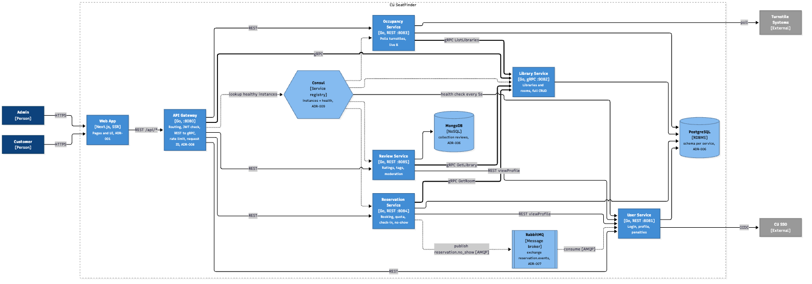

# CU SeatFinder

Live library occupancy and meeting-room booking for Chulalongkorn University.

Students waste time walking between libraries looking for a free seat. CU SeatFinder
shows how full each campus library is right now, lets students and staff book a
meeting room, filter for quiet libraries, and review library conditions. Admins
accept bookings, check people in, and moderate reviews.

The UI is in Thai by default, with English available.

## Features

| | Customers (students, staff) | Admins (library staff) |
| :- | :- | :- |
| **Sign in** | University account (mock OIDC for now) | Email and password |
| **Occupancy** | Live percentage per library, with a "last updated" warning when data is late | |
| **Filter** | Libraries by occupancy, least crowded first | |
| **Rooms** | Book a meeting room in the future, cancel it, get a booking reference | Accept or reject bookings, check in by booking reference, lift no-show penalties |
| **Reviews** | Star rating, tags and comment | Hide or remove flagged reviews |

A booking that is never checked in counts as a no-show and blocks the user from
booking for 7 days.

## Architecture



- **Frontend:** Next.js and TailwindCSS (`frontend/`). Every `/api/*` call goes to the gateway.
- **API Gateway:** Go (`backend/cmd/gateway`). Checks the JWT, applies rate limits and routes each path to its service. It also translates REST to gRPC for the Library Service.
- **Five Go services** (`backend/cmd/`):
  - **User:** sign-in, profiles, no-show penalties.
  - **Library:** libraries and rooms, served over **gRPC** ([proto/library/v1/library.proto](proto/library/v1/library.proto)).
  - **Occupancy:** polls turnstile data (simulated for now) and computes live occupancy.
  - **Reservation:** bookings, quotas, check-in, no-show detection.
  - **Review:** ratings, tags, moderation.
- **Data:** PostgreSQL holds one schema per service; reviews are stored in MongoDB.
- **Messaging:** RabbitMQ. Reservation publishes `reservation.no_show`; User consumes it and applies the penalty.
- **Service discovery:** Consul. Each service registers with a health check, and callers look up healthy instances by name.

The reasoning behind each choice is in the Architecture Decision Records (ADRs) in
[docs/Proposal.md](docs/Proposal.md).

## Run it

You need Docker. For the UI tests you also need Node and pnpm.

```bash
cd backend
make up      # builds and starts every container
make down    # stops them
```

| URL | What |
| :- | :- |
| http://localhost:3000 | Web app |
| http://localhost:8080 | API Gateway |
| http://localhost:8500 | Consul UI (services and health) |
| http://localhost:15672 | RabbitMQ UI (`seat` / `seat`) |

The seeded admin account is `admin@cu.ac.th` / `admin123`. Customers sign in with any
student ID; there is no password while the mock identity provider is in use.

`make demo-seed` adds sample reviews and a pending booking.

To develop on the host without Docker for the services, run `make db && make run`
in `backend/` and `pnpm install && pnpm dev` in `frontend/`. This mode does not use
Consul. More details: [backend/README.md](backend/README.md).

## Tests

All of these run against the stack started by `make up`. Run the `make` targets from `backend/`.

| Command | Checks |
| :- | :- |
| `cd backend && make test` | Go unit tests (booking rules, quota) |
| `make loadtest` | k6 load test: 50 users, p95 under 1 s for reservations and under 500 ms for reads |
| `make stresstest` | k6 stress test: steps of 50, 100, 200 and 400 users, then recovery |
| `make nfr-security` | Every protected route rejects a missing or forged JWT and the wrong role |
| `make nfr-resilience` | Occupancy freshness, crash recovery of a replica, and backup restore |
| `cd frontend && pnpm test:nfr` | Mobile layout at 375 px, steps needed to book, Thai/English switch |

Results from 5 Nov 2026: every check passed, and no breaking point was found up to
400 users on one machine. See the Load Test Plan and NFR Verification sections in
[docs/Proposal.md](docs/Proposal.md).

## Not built yet

- Real CU SSO (OIDC) sign-in
- Choosing a room on a map
- Scanning QR codes with a camera
- Photos in reviews
- Profile activity
- A daily backup schedule; `make backup` works but nothing runs it automatically
- PDPA consent

## Repository layout

```
frontend/      Next.js web app
backend/       Go gateway and services (cmd/), shared packages (internal/)
proto/         gRPC definitions for the Library Service
loadtest/      k6 scripts and NFR test scripts
docs/          Proposal and ADRs (Proposal.md, Proposal-ADR.docx), C4 and sequence diagrams
```

## Team

- Chatrin Yoonchalard 6631304721
- Chayaphon Kultanon 6631306021
- Nantaporn Phuaphanbun 6631330021
