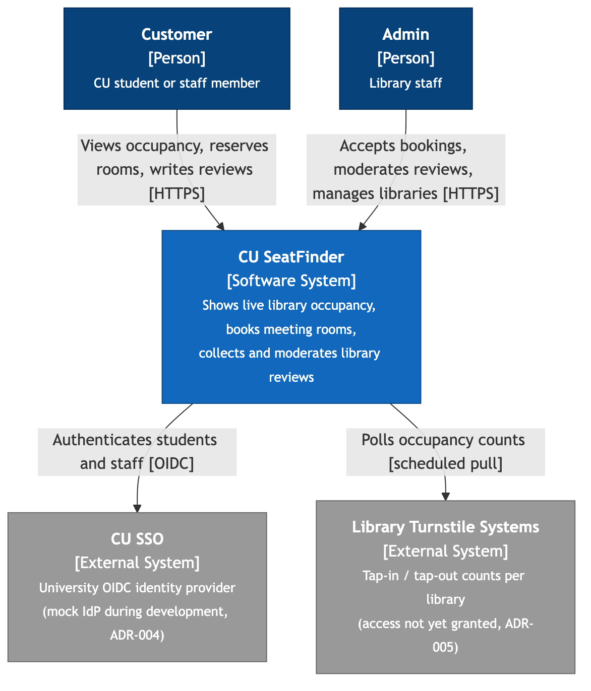
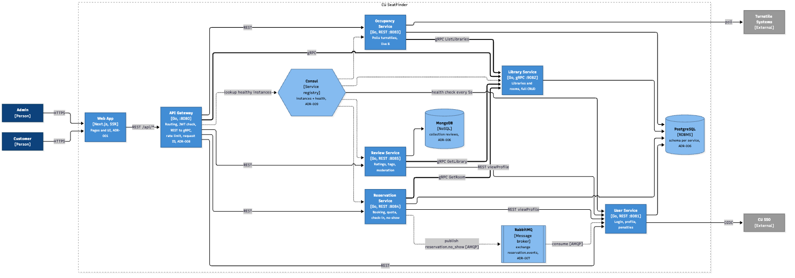
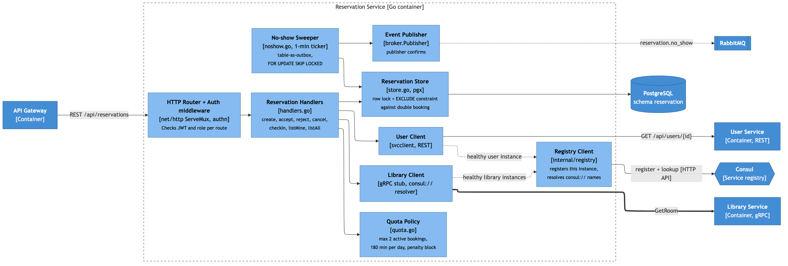
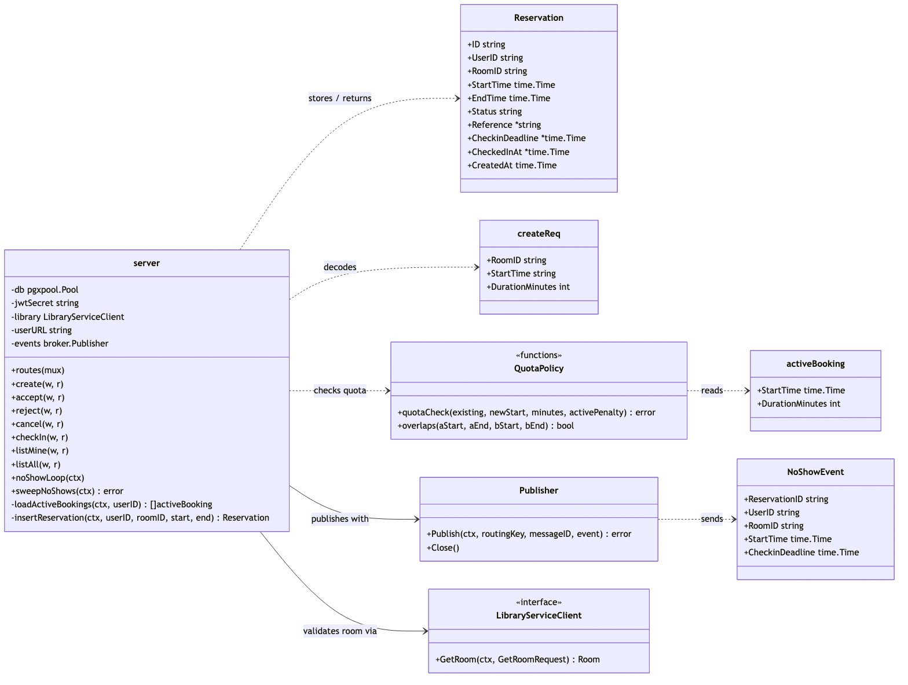
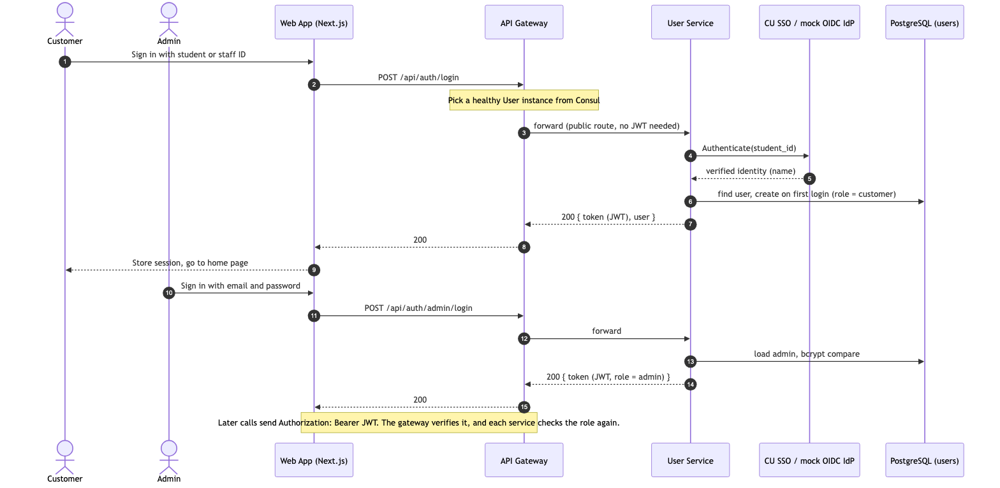
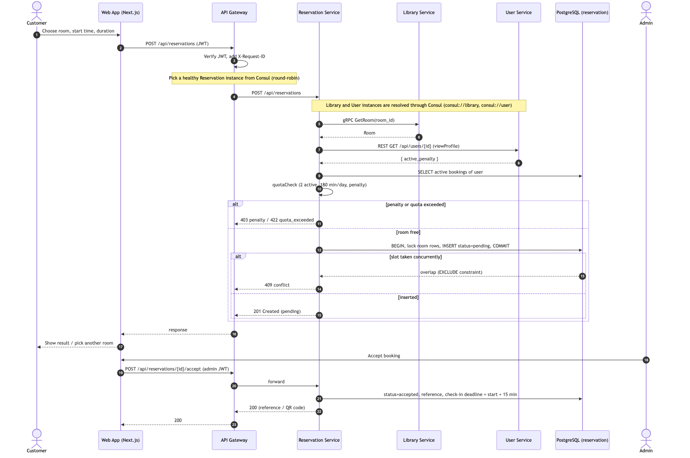
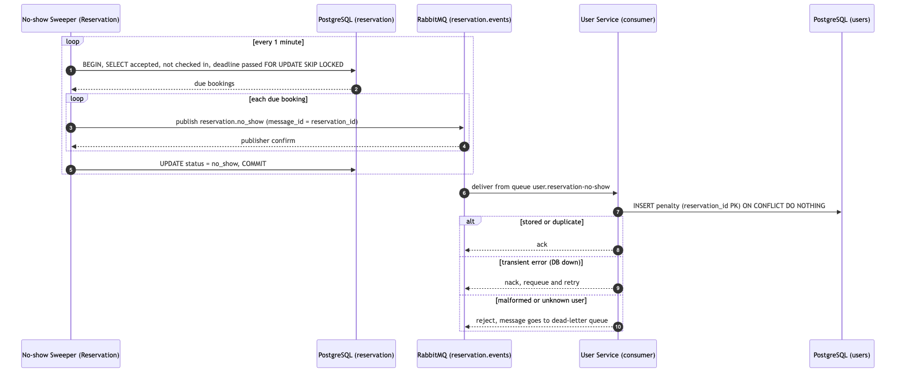

# **CU SeatFinder**

# **Project Description & Architecture Decision Records**

## **Group Members**

* Chatrin Yoonchalard 6631304721
* Chayaphon Kultanon 6631306021
* Nantaporn Phuaphanbun 6631330021

## **Problem Description**

University students lack real-time visibility into study space availability across campus libraries, forcing them to manually search between locations, which wastes valuable time and increases daily frustration. CU SeatFinder addresses this by aggregating live occupancy data from library check-in systems and giving students and staff a single place to view density, reserve meeting rooms, filter for available space, and share reviews of library conditions.

## **Target Customers**

* Admin: Manages library data, monitors occupancy trends, and moderates reviews.
* Customer: University Student and University Staff views occupancy, reserves meeting rooms, filters libraries, and writes reviews.

## **Scenario Overview (Use Cases)**

* Sign In / Sign Out (authentication): customers sign in with their university account; admins sign in with email and password.
* View Seat Density see how crowded each library currently is.
* Reserve Meeting Room book a meeting room in advance.
* Filter Empty Libraries filter to find which libraries currently have free space.
* Review Library: leaves a review of a library.

## **Use Case Details**

### **UC-00: Sign In / Sign Out (Authentication)**

| Use Case Name: Sign In / Sign Out | ID: UC-00 |
| :---- | :---- |
| Importance Level: High | Use Case Type: Security / Authentication |
| Primary Actor: Customer (Student / Staff), Admin |  |
| Stakeholders and Interests: Customer: Wants to sign in with the university account they already have, without creating another password. Admin: Wants only verified university members to book rooms and write reviews, and wants admin functions behind a separate login. |  |
| Brief Description: A customer signs in through the university identity provider (CU SSO, OIDC); an admin signs in with email and password. The system issues a JWT session that every later request carries through the API Gateway. |  |
| Trigger: User opens the app without a valid session, or taps "Sign in". |  |
| Type: External |  |
| Relationships: Required by UC-02 Reserve Meeting Room and UC-04 Review Library, which need a signed-in user. |  |
| Precondition: Customer holds a university account; admin holds an admin account created by the team. |  |
| Postcondition: A JWT session carrying the user's role (customer or admin) is issued; after sign-out the session is cleared. |  |
| Normal Flow of Events: 1. User opens the sign-in page. 2. Customer chooses "Sign in with CU account"; the User Service verifies the identity with the university IdP (a mock OIDC provider during development, ADR-004). 3. On first sign-in, the system creates the customer's profile. 4. The User Service issues a JWT containing the user ID and role. 5. The app stores the session; every later request sends it to the API Gateway, which verifies it before routing (ADR-008). 6. User taps "Sign out" and the session is cleared. |  |
| Subflows: Admin Sign-in: Admin enters email and password; the User Service checks the bcrypt password hash and issues a JWT with role admin. |  |
| Alternate/Exceptional Flow: Invalid Credentials: The system shows an error and the user stays on the sign-in page. Expired or Invalid Token: The API Gateway rejects the request with 401 and the app returns the user to the sign-in page. Penalized Account: Sign-in succeeds, but booking is blocked while a no-show penalty is active (UC-02). |  |

### **UC-01: View Seat Density**

| Use Case Name: View Seat Density | ID: UC-01 |
| :---- | :---- |
| Importance Level: High | Use Case Type: Informational / Real-time |
| Primary Actor: Customer (Student / Staff) |  |
| Stakeholders and Interests: Customer: Wants to see live capacity percentages across libraries at a glance to choose a low-density study spot before arriving. Admin: Wants automated, accurate tracking of library traffic without manual counting. |  |
| Brief Description: The user views live occupancy percentages displayed on the library list. |  |
| Trigger: Customer opens the app home screen or navigates to the "Libraries" tab. |  |
| Type: External |  |
| Relationships: Depends on Library Turnstile Check-in/Check-out Database Service. |  |
| Precondition: Customer is on the main app screen; Library Turnstile Check-in/Check-out system is operational. |  |
| Postcondition: Customer gains clear visibility into current library capacity percentages. |  |
| Normal Flow of Events: 1. System queries the library turnstile check-in/check-out database for current tap-in and tap-out logs. 2. System calculates live occupancy percentages for all available libraries. 3. System displays the main library list showing each library's name alongside its live occupancy percentage badge (e.g., Chula Central Library   45% Occupied). 4. Customer views the list and taps on a specific library. |  |
| Subflows: None. |  |
| Alternate/Exceptional Flow: Data Delay / Database Disconnection: If real-time check-in updates are delayed or connection drops, the system displays the last calculated percentages with a "Last updated [X] mins ago" warning indicator on the list. |  |

### **UC-02: Reserve Meeting Room**

| Use Case Name: Reserve Meeting Room | ID: UC-02 |
| :---- | :---- |
| Importance Level: High | Use Case Type: Business / Transactional |
| Primary Actor: Customer (Student / Staff) |  |
| Stakeholders and Interests: Customer: Wants to secure a specific meeting room for a planned session. Admin: Wants fair usage, reduced no-shows, and optimal resource allocation. |  |
| Brief Description: The customer selects an available meeting room, sets a time duration, and confirms a meeting room reservation. |  |
| Trigger: Customer selects an available meeting room and taps "Book Meeting Room". |  |
| Type: External |  |
| Relationships: Depends on Library Database Service. |  |
| Precondition: Customer is authenticated/logged in; target meeting room is in "Available" status. |  |
| Postcondition: Meeting room status changes to "Reserved"; booking confirmation ticket/QR code is issued with a check-in countdown timer. |  |
| Normal Flow of Events: 1. Customer selects an available meeting room on the map. 2. Customer inputs reservation details (start time, duration). 3. System verifies booking eligibility against quota and daily time limits. 4. System prompts customer to confirm booking details. 5. Customer confirms reservation. 6. Admin accepts the reservation. 7. System locks meeting room status to "Reserved" and generates a booking reference/QR code. |  |
| Subflows: Quota Check: System verifies if the customer has existing active bookings or active penalties. |  |
| Alternate/Exceptional Flow: Booking Conflict: If another user books the meeting room simultaneously, the system prompts the customer to select a different meeting room. Limit Reached: If the customer exceeds daily booking hours or active booking quotas, the system blocks the transaction and displays a limit error message. |  |

### **UC-03: Filter Empty Libraries**

| Use Case Name: Filter Empty Libraries | ID: UC-03 |
| :---- | :---- |
| Importance Level: Medium | Use Case Type: Informational / Search |
| Primary Actor: Customer (Student / Staff) |  |
| Stakeholders and Interests: Customer: Wants to quickly discover which campus libraries currently have the highest number of free seats or specific amenities. Admin: Wants to offload crowded main libraries by directing students to quieter, lesser-known locations. |  |
| Brief Description: The customer sets criteria (e.g., maximum occupancy %, minimun occupancy %) to find libraries across campus that currently have low traffic. |  |
| Trigger: Customer applies filter criteria on the main discovery/search screen. |  |
| Type: External |  |
| Relationships: Depends on Uses View Seat Density (UC-01). |  |
| Precondition: Customer is on the main discovery page. |  |
| Postcondition: System displays a filtered list of libraries ranked by availability or match percentage. |  |
| Normal Flow of Events: 1. Customer opens search/filter controls. 2. Customer selects filter parameters (e.g., Occupancy < 50%). 3. Customer submits filter query. 4. System filters and sorts campus libraries matching criteria from least crowded to most crowded. 5. System presents the filtered list to the customer. |  |
| Subflows: None. |  |
| Alternate/Exceptional Flow: No Match: If no library meets the criteria (e.g., exam week high traffic), the system suggests the least busy alternative location currently available. |  |

### **UC-04: Review Library**

| Use Case Name: Review Library | ID: UC-04 |
| :---- | :---- |
| Importance Level: Medium | Use Case Type: User-Generated Content / Transactional |
| Primary Actor: Customer (Student / Staff) |  |
| Stakeholders and Interests: Customer: Wants to share feedback on noise level, cleanliness, temperature, or wifi quality, and read peer recommendations. Admin: Wants feedback on library conditions to maintain facilities and improve service quality. |  |
| Brief Description: Customer submits a star rating, category tags (e.g., Quiet, Cold, Strong Wi-Fi), and optional written feedback for a library location. |  |
| Trigger: Customer taps "Write a Review" on a library detail page. |  |
| Type: External |  |
| Relationships: None. |  |
| Precondition: Customer is authenticated/logged in. |  |
| Postcondition: Review is posted, library average rating is recalculated, and review is flagged for admin moderation if needed. |  |
| Normal Flow of Events: 1. Customer navigates to a library's profile page and selects "Write Review". 2. Customer selects star rating and specific tags (e.g., Noise Level, Wi-Fi speed). 3. Customer enters text comments and optional photos. 4. Customer submits the review. 5. System saves the review, updates average score display, and updates customer profile activity. |  |
| Subflows: None. |  |
| Alternate/Exceptional Flow: Inappropriate Content Filter: If text triggers automated profanity/policy filters, the system prompts the customer to revise text before submission. |  |

## **Functional Requirements**

### **User Registration & Login System**

* The system shall allow students and staff to register/log in using their university account (SSO) or student/staff ID.
* The system shall allow admins to log in with elevated permissions to manage library data.
* The system shall allow customers and admins to log out securely.

### **Seat Density & Occupancy System**

* The system shall display real-time occupancy percentages for each library, floor, or zone.
* The system shall calculate occupancy based on turnstile check-in/check-out data.
* The system shall display a "Last updated [X] mins ago" indicator when live data is delayed.

### **Meeting Room Reservation System**

* The system shall allow customers to reserve an available meeting room with a start time and duration.
* The system shall enforce booking quotas and daily time limits per customer.
* The system shall allow admin to accept the customer’s reservation.
* The system shall issue a booking reference/QR code with a check-in countdown timer upon confirmation.
* The system shall prevent double-booking of the same meeting room and prompt the customer to choose another seat on conflict.

### **Filter & Discovery System**

* The system shall allow customers to filter libraries by occupancy percentage and amenities.
* The system shall rank and sort filtered results from least crowded to most crowded.
* The system shall suggest the next-best alternative location when no library matches the filter criteria.

### **Review System**

* The system shall allow customers to submit a star rating, category tags, and written feedback for a library.
* The system shall recalculate and display each library's average rating after a new review is submitted.
* The system shall filter submitted text against a profanity/policy filter before publishing.
* The system shall allow admins to moderate (hide/remove) flagged or inappropriate reviews.

### **Admin System**

* The system shall allow admins to manage the reservation.
* The system shall allow admins to manage moderation of customer reviews.

## **Non-Functional Requirements**

### **Operational**

* The system shall display properly on mobile devices.
* The system shall back up occupancy, reservation, and review data daily.

### **Performance**

* The system shall reflect updated occupancy data within two poll intervals (60 seconds at the default 30-second interval) of the source check-in/check-out event.
* The system shall respond to reservation requests (create, accept, cancel) within 1 second at the 95th percentile with 50 concurrent users, measured end to end through the API Gateway.
* The system shall respond to occupancy, library and review read requests within 500 ms at the 95th percentile under the same load.
* The system shall keep the error rate (5xx responses and timeouts) below 1% under the same load.
* The system shall operate with an uptime of at least 99%; every service exposes a health check and restarts automatically after a crash (ADR-009).

### **Security**

* The system shall enforce authentication via university account (SSO) with JWT-based sessions.
* The system shall provide role-based access control (Admin, Customer).
* The API Gateway shall verify the JWT of every protected request before it reaches a service, and each service shall check the user's role again.
* The system shall protect personal and usage data in accordance with Thailand's Personal Data Protection Act (PDPA).

### **Usability**

* The system shall be designed with a responsive UI.
* The system shall provide intuitive navigation for both customers and admins.
* The system shall minimize the number of steps needed to check occupancy and reserve a meeting room.

### **Cultural**

* The system shall provide a Thai language user interface, with English as optional.

# **Architecture Decision Records (ADRs)**

### **ADR-001: Frontend Framework**

**Context**

The occupancy list has to load fast on students' phones over campus Wi-Fi. Options: React SPA (CRA), Vue, Angular, Next.js. An SPA shows a blank screen until its JavaScript loads, and Angular is heavier than a three-person team needs. SEO is not a factor here; the whole app sits behind university SSO (ADR-004), so no page is publicly indexable. Next.js renders the first page on the server while keeping the React component model the team already knows, and its file-based routing and data-fetching conventions remove setup work the team would otherwise write by hand.

**Decision**

Next.js with server-side rendering. Live occupancy is refreshed by client-side polling, not WebSockets, matching the backend's own polling model (ADR-005). Next.js serves pages only: every /api/\* call, from the browser or from server-side rendering, goes to the API Gateway (ADR-008).

**Status**

Accepted

**Consequences**

* Requires a Node runtime to deploy; static hosting is no longer an option.
* Needs an explicit per-route caching/revalidation policy, or Next.js's default caching will serve stale occupancy numbers.
* The team must learn Next.js's server vs. client rendering model.
* Occupancy is only ever as fresh as the last poll.
* Next.js keeps no list of backend services and no gRPC client; adding or moving a service is a gateway change only (ADR-008).

### **ADR-002: Styling Approach**

**Context**

Screens are dense (occupancy badges, filter panels, star ratings) and the team iterates on layout constantly. Options: Ant Design, Bootstrap, TailwindCSS. Ant Design's components resist customization. Bootstrap's styling looks dated. TailwindCSS applies styles as utility classes directly in markup, so layout changes need no separate stylesheet round-trip during iteration, and the app's visual identity is defined by the team rather than inherited from a library's defaults.

**Decision**

TailwindCSS utility classes, with no component library.

**Status**

Accepted

**Consequences**

* Every component (occupancy badges, room cards, rating widgets) must be built from scratch.
* Accessibility (focus states, ARIA patterns) is manual work; no component library supplies it.
* Long utility class lists need agreed conventions to stay readable.
* Visual consistency depends on team discipline rather than an enforced design system.

### **ADR-003: Backend Language & Framework**

**Context**

The API polls turnstile sources on a schedule and enforces reservation rules. Options: Node/NestJS, Django, Go. Polling a few endpoints every few minutes is not a high-concurrency workload, so throughput is not the deciding factor.  Go is chosen for static typing over the reservation logic and single-binary deployment.

**Decision**

Go. Clients call the backend over REST through the API Gateway (ADR-008), which also translates REST to gRPC for the Library Service. Services call the Library Service over gRPC and the User Service over REST; Reservation and User exchange asynchronous events through RabbitMQ (ADR-007).

**Status**

Accepted

**Consequences**

* Deployment is a single compiled binary, with no language runtime to install on the server.
* Smaller package ecosystem than Node; some utilities will be written in-house.
* No team member has written Go before, so the schedule has to absorb ramp-up on its idioms and concurrency patterns.

### **ADR-004: Login & Identity**

**Context**

Every student and staff member already holds a university account. Options: build our own email/password signup, phone OTP, or integrate CU's SSO. Our own credential store adds signup friction and one more place passwords can leak; phone OTP carries per-message cost and still doesn't verify that the user is affiliated with the university. CU SSO verifies student/staff status as a side effect of login and keeps passwords out of our system entirely. Admin accounts, however, may belong to library staff outside the SSO directory.

**Decision**

Authenticate students and staff through CU SSO (OAuth2/OIDC), issuing JWT sessions after login, with a separate email/password path for administrative accounts. During development, run against a local OIDC-compatible mock identity provider so that login-dependent features can be built and tested without network access or real student accounts.

**Status**

Accepted

**Consequences**

* Auth has to sit behind an interface from day one so the mock and the real IdP are interchangeable; skipping this makes the swap a refactor.
* Login availability is now tied to the university SSO service's uptime, which the team does not control.
* A second, independent auth path has to be built and secured for admin accounts outside the SSO directory.
* No student password is ever stored, since credential handling is delegated to the IdP.

### **ADR-005: Turnstile Data Ingestion**

**Context**

No library has granted access to its turnstile/check-in data yet. Options: each library pushes updates to us (webhooks), or our backend pulls counts on a timer. Push requires every library's IT team to build something new before we can launch.

**Decision**

Poll each library's turnstile data source on a short interval, assuming an accessible export or endpoint can be negotiated.

**Status**

Proposed. Access has not been arranged, so this cannot be finalized yet.

**Consequences**

* Access must still be requested from each library's IT/facilities staff: unstarted work, not a formality.
* Needs a scheduler on the backend (Go's time.Ticker or a cron library) to drive polling.
* Missed tap-outs make counts drift upward over time; a reconciliation strategy is required (e.g., daily reset at closing, capping and flagging anomalies).
* Occupancy lags by up to one poll interval.
* If access turns out to be a daily CSV rather than a queryable database, this design has to be revisited.

### **ADR-006: Database Selection**

**Context**

The system stores three kinds of data: reservations, which need transactional writes so two customers cannot be granted the same room and time slot; reviews, which carry a variable set of tags chosen from a fixed list (for example quiet, strong Wi-Fi, many outlets) and do not need a strict schema; and occupancy logs from turnstile polling (ADR-005), which are append-heavy time-series rows read for recent trends.

Options: MongoDB, MySQL, PostgreSQL. MongoDB has no cross-document constraint that prevents a duplicate booking, so the guarantee would have to be enforced in application code - the wrong place for it. It does suit reviews, since the shape of a review is likely to change and new fields can be added without migrations. MySQL and PostgreSQL both provide transactional writes; PostgreSQL was preferred for richer indexing on timestamp ranges. Because the data has different needs, reservations and occupancy logs go to PostgreSQL and reviews go to MongoDB.

For hosting, options for PostgreSQL were Prisma Postgres, Supabase, and Neon (all managed PostgreSQL). Prisma Postgres was chosen for its free tier and minimal setup, since none of these require the team to operate a database server. One consequence of that choice is worth stating: Prisma ORM, the tool usually paired with Prisma Postgres, is Node/TypeScript-only and has no supported Go client, so the Go backend (ADR-003) cannot use it. For MongoDB, MongoDB Atlas (managed) was chosen for the same reason, with a free tier.

**Decision**

PostgreSQL hosted on Prisma Postgres for the User, Library, Occupancy and Reservation services (one schema per service), and MongoDB hosted on MongoDB Atlas for the Review service (collection reviews). The Go backend will use Go-native libraries: pgx for PostgreSQL (not Prisma ORM) and the official MongoDB Go driver for MongoDB.

**Status**

Accepted

**Consequences**

* Row-level locking inside a PostgreSQL transaction is what actually enforces the no-double-booking rule for reservations in UC-02. Reservations must not be moved to MongoDB.
* The review schema can evolve (new tags, new fields) without migrations, so the review service can change independently of the other data.
* Reviews refer to users and libraries by ID only. There are no foreign keys across databases, so orphaned reviews are possible and must be handled in application code, and the Go layer should validate input (rating range, allowed tag keys) to keep the collection from drifting.
* No SQL joins between reviews and libraries; pages that need both are assembled in the application layer. There are no cross-database transactions, which is acceptable because reviews are never written atomically with reservations.
* No Prisma ORM types or migration CLI on the Go side; PostgreSQL migrations need a separate tool (golang-migrate, or Prisma’s CLI as a dev-only step). MongoDB needs no schema migrations, but its indexes must be managed in code.
* The team now runs, monitors, and secures two data stores, and depends on the managed hosting availability and free-tier limits of both Prisma Postgres and MongoDB Atlas.
* The reservations table also serves as the outbox for no-show events (ADR-007). Its row lock keeps a staff check-in and the no-show check from both acting on the same booking.
* Each service reads and writes only its own schema (users, library, occupancy, reservation) or, for Review, its own MongoDB collection. Data owned by another service is obtained through that service's API, never by querying its tables, so a schema can later move to its own instance with only a connection-string change.

### **ADR-007: Asynchronous Messaging (Message Broker)**

**Context**

A student who books a meeting room but never checks in should be blocked from booking for a while (UC-02: "reduced no-shows"). Detecting a no-show is the Reservation Service's job, but penalties belong to the User Service, which Reservation already reads through viewProfile(). If Reservation called User synchronously to write the penalty, the two would have to be up at the same time: if User is down, the penalty is either lost or the check has to stall. The penalty does not need to take effect instantly; a delay of a minute or two is acceptable.

Options: a synchronous REST call with retries, RabbitMQ, Kafka, and Redis Streams. Kafka is built for high-throughput event streams and replay, which is more to operate than a few events a day justifies. Redis Streams would add Redis for this alone and has no built-in dead-lettering. RabbitMQ provides durable queues, publisher confirms, per-message acknowledgement, and dead-letter routing out of the box, and runs as a single container in development.

**Decision**

RabbitMQ, with a topic exchange reservation.events. The Reservation Service publishes reservation.no_show when an accepted booking passes its check-in deadline without a check-in. The User Service consumes the event from the durable queue user.reservation-no-show and records a 7-day penalty. Messages the consumer cannot process go to a dead-letter queue. Delivery is at-least-once:

* Once a minute, Reservation locks the due rows (SELECT ... FOR UPDATE SKIP LOCKED), publishes each event, waits for the broker's confirm, and only then marks the rows no_show. The reservations table acts as the outbox, so no separate outbox table is needed.
* The User Service keys penalties by reservation_id, so a redelivered event changes nothing.

**Status**

Accepted

**Consequences**

* Reservation and User no longer need to be available at the same time. While User is down, events wait in the queue. While RabbitMQ is down, bookings stay accepted and are published on the next check.
* Penalties are eventually consistent: they apply up to about a minute after the deadline, or later if the broker is down.
* The database and the broker cannot share a transaction, so an event can be published twice (for example, a crash after publishing but before the update). Every consumer must be idempotent. A future event triggered directly by a user request, with no periodic re-check to retry it, would need a real outbox table.
* A third piece of infrastructure to run and monitor, alongside PostgreSQL and MongoDB. Production hosting has not been chosen yet.
* The dead-letter queue must be watched: each message there is a penalty that was never applied.
* The event payload becomes a contract between services; changing its fields means updating both publisher and consumer.

### **ADR-008: API Gateway**

**Context**

The browser currently reaches four REST services through Next.js rewrites, and Next.js route handlers translate REST to gRPC for the Library Service. Backend routing and a gRPC client therefore live inside the frontend, every service parses tokens and handles CORS on its own, and there is no single place to log, time or rate-limit requests, which the load tests for the performance quality attribute need.

Options: keep the Next.js rewrites as a Backend-for-Frontend; an off-the-shelf gateway (Traefik, Kong, NGINX); or a small gateway written in Go. Off-the-shelf gateways route HTTP well, but REST-to-gRPC translation needs plugins or a separate grpc-gateway build with annotated protos, and each brings its own configuration language. A Go gateway reuses the team's JWT package (internal/authn) and the generated Library gRPC client, and is one more binary in the same build (ADR-003).

**Decision**

A dedicated API Gateway written in Go (cmd/gateway, port 8080) is the only entry point for /api/\* traffic. Next.js forwards every /api/\* call to it and keeps no service addresses. The gateway:

* routes each path prefix to the service that owns it through a reverse proxy (route table in Step 4);
* verifies the JWT on protected routes and returns 401 before the request reaches a service;
* translates /api/libraries and /api/rooms from REST/JSON into LibraryService gRPC calls;
* applies per-client rate limiting and a timeout to every upstream call;
* adds an X-Request-ID header and logs method, path, status and latency for every request.

Services still check the user's role themselves (defence in depth) and are reachable directly only inside the Docker network.

**Status**

Accepted

**Consequences**

* The gateway is a single point of failure and a possible bottleneck. It must stay stateless so it can restart quickly or run as several replicas (Risk Matrix R2), and its capacity is measured in the stress test.
* Every request takes one extra network hop; the added latency has to fit inside the 1-second reservation target.
* The REST-to-gRPC facade moves from Next.js into the gateway, so the frontend loses its gRPC dependency, and the facade has to be kept in step with library.proto.
* Adding a service means adding one route in the gateway; nothing changes in the frontend.
* Request logs with latency and request IDs give one place to read response times during load tests.

### **ADR-009: Service Discovery & Deployment**

**Context**

The gateway, five services, two databases and a message broker have to find each other. Options: a service registry (Consul, Eureka) with client-side lookup; Kubernetes Services with DNS; or Docker Compose networking, where each container is reached by name and addresses are passed as environment variables. A registry adds a component to operate and a client library in every service, which a fixed set of five services on one host does not need. Kubernetes solves discovery and scaling but is more to learn and operate than the project timeline allows.

**Decision**

Run every container with Docker Compose on one network. Each service is reached by its Compose service name through Docker's built-in DNS, so discovery is done by the platform (server-side discovery): for example LIBRARY_GRPC_ADDR=library:9082 and USER_URL=http://user:8081. Addresses are plain environment variables, so the same binaries run unchanged under Kubernetes Service DNS later. Every service exposes a health check (GET /healthz, or grpc.health.v1 for the Library Service), and Compose restarts a crashed container (restart: unless-stopped).

**Status**

Accepted

**Consequences**

* No registry to run; discovery is a DNS lookup handled by Docker.
* No client-side load balancing or health-aware routing: requests to a crashed container fail until Compose restarts it.
* Several replicas of one service are balanced only by Docker DNS round-robin, and everything runs on one host.
* The environment variables are the contract between services; renaming a service means updating its variable everywhere it is used.
* Moving to Kubernetes later needs Deployment and Service manifests, but no code changes.

# **Microservice architecture**

# **Step 1 Identify system operations**

System operations are abstractions of external requests derived from the use cases (UC-00 to UC-04) and the actors (Customer, Admin):

* registerUser(), login(), adminLogin(), logout(): UC-00 Sign In / Sign Out, via mock OIDC for customers (ADR-004) and email/password for admins
* getOccupancy(): UC-01 View Seat Density
* filterLibraries(): UC-03 Filter Empty Libraries
* createReservation(): UC-02 Reserve Meeting Room
* acceptReservation(), rejectReservation(): UC-02, Admin reviews the booking
* cancelReservation(): UC-02, Customer cancels a pending or accepted booking
* checkIn(): UC-02, staff scan the booking QR code at the room
* createReview(), updateReview(), deleteReview(): UC-04 Review Library
* moderateReview(): UC-04, Admin moderation
* manageLibraries(): Admin creates, edits and deletes libraries and meeting rooms
* unbanUser(): Admin lifts a no-show penalty

# **Step 2 Identify services**

Services are organized around business capabilities rather than technical layers, giving five services:

* User Service: authentication, profile management, and booking penalties
* Library Service: library and meeting room master data
* Occupancy Service: turnstile polling and live occupancy calculation (ADR-005)
* Reservation Service: meeting room booking, quota, QR check-in, and no-show detection
* Review Service: ratings, tags, and moderation

The Occupancy Service is kept separate from the Library Service because the turnstile ingestion pipeline is an unreliable, still-unnegotiated external dependency (ADR-005); isolating it means a polling failure does not take down library browsing.

Penalties are applied by the User Service rather than the Reservation Service, because a penalty is part of the user's account standing, which the User Service owns; Reservation only reports that a no-show happened. The two communicate through RabbitMQ (ADR-007) rather than a direct call, so neither has to be available for the other to keep working.

The API Gateway is not a business service: it owns no data and implements no use case. It is the single entry point that routes each /api/\* request to the service that owns it, verifies the JWT, and translates REST to gRPC for the Library Service (ADR-008). Keeping these cross-cutting concerns in one place means the five business services never deal with the browser directly.

# **Step 3 Service APIs and collaborations**

Each row below lists a service, the operations it exposes, and which other services it collaborates with to fulfil each system operation. (REST) and (gRPC) mark synchronous calls; (async) marks an event delivered through RabbitMQ (ADR-007).

| Service | Operation | Collaboration |
| :---- | :---- | :---- |
| **API Gateway** (Go, port 8080) | route() verifyJWT() translateLibraryCall() rateLimit() | (REST) forwards /api/auth and /api/users to User, /api/occupancy to Occupancy, /api/reservations to Reservation, /api/reviews to Review (gRPC) translates /api/libraries and /api/rooms into LibraryService calls Upstream addresses come from environment variables resolved by Docker DNS (ADR-009) |
| **User Service** (REST) | registerUser() login() adminLogin() logout() editProfile() viewProfile() applyPenalty() listPenalized() unbanUser() | Auth interface: mock OIDC identity provider; swapped for CU SSO once credentials are issued (ADR-004) (async) Reservation Service, via RabbitMQ: consumes reservation.no_show and records a 7-day penalty keyed by reservation_id (ADR-007) Data store: PostgreSQL schema users |
| **Library Service** (gRPC) | ListLibraries() GetLibrary() CreateLibrary() UpdateLibrary() DeleteLibrary() ListRooms() GetRoom() CreateRoom() UpdateRoom() DeleteRoom() | Source of truth for library, floor, zone and meeting room master data, exposed as LibraryService in proto/library/v1/library.proto Writes require an admin JWT in gRPC metadata Data store: PostgreSQL schema library |
| **Occupancy Service** (REST) | pollTurnstileData() calculateOccupancy() getOccupancy() | (gRPC) Library Service: ListLibraries(): polls only libraries that exist Turnstile source behind an interface; a mock generator until access is granted (ADR-005) Data store: PostgreSQL schema occupancy |
| **Reservation Service** (REST) | createReservation() acceptReservation() rejectReservation() cancelReservation() checkQuota() checkIn() detectNoShow() | (gRPC) Library Service: GetRoom(): validates the room before booking (REST) User Service: viewProfile(): checks active penalties for the quota rule (async) User Service, via RabbitMQ: publishes reservation.no_show when an accepted booking passes its check-in deadline without a check-in (ADR-007) Data store: PostgreSQL schema reservation; a row lock plus an EXCLUDE constraint prevent double booking (ADR-006) |
| **Review Service** (REST) | createReview() getReviews() getReview() updateReview() deleteReview() moderateReview() getFlaggedReviews() | (gRPC) Library Service: GetLibrary(): validates the library before a review is stored (REST) User Service: viewProfile(): attaches reviewer identity Data store: MongoDB reviews collection (ADR-006); no other service reads it. getReviews() computes the average rating on read. |

# **Step 4 API Gateway routing and service discovery**

All client traffic enters through the API Gateway (ADR-008). The gateway finds each service by its Docker Compose name through Docker's built-in DNS (ADR-009); the address of every upstream is an environment variable, so no service registry is needed.

| Path prefix | Upstream (DNS name) | Protocol | Access at the gateway |
| :---- | :---- | :---- | :---- |
| /api/auth/\* | user:8081 | REST | Public |
| /api/users/\* | user:8081 | REST | JWT required; penalty admin routes need role admin |
| /api/occupancy/\* | occupancy:8083 | REST | Public |
| /api/reservations/\* | reservation:8084 | REST | JWT required; accept, reject and check-in need role admin |
| /api/reviews/\* | review:8085 | REST | GET public; writes need JWT; moderation needs role admin |
| /api/libraries/\* /api/rooms/\* | library:9082 | gRPC (translated by the gateway) | GET public; create, update and delete need role admin |

Service-to-service calls inside the network use the same mechanism: Reservation, Review and Occupancy reach the Library Service at LIBRARY_GRPC_ADDR=library:9082, Reservation and Review reach the User Service at USER_URL=http://user:8081, and the data stores are reached at postgres:5432, mongo:27017 and rabbitmq:5672. Next.js reaches the gateway at GATEWAY_URL=http://gateway:8080. A health check on every container (GET /healthz, grpc.health.v1 for Library) lets Compose report and restart unhealthy services.

# **System Architecture (C4 Model)**

The architecture is described with the C4 model at four levels of detail: the system in its context, its containers, the components inside one container, and the code of that container. Diagram sources are Mermaid files in docs/diagrams/.

### **Level 1: System Context**

*Figure 1: C4 Level 1, System Context*

CU SeatFinder is used by customers (students and staff) and admins (library staff). It depends on two external systems the team does not control: CU SSO for identity (ADR-004) and the library turnstile systems for occupancy counts (ADR-005).

### **Level 2: Containers**

*Figure 2: C4 Level 2, Containers. Thick lines are gRPC; dotted lines are asynchronous events through RabbitMQ (ADR-007).*

The Web App renders pages and sends every API call to the API Gateway (ADR-008), which routes REST calls to four services and translates library calls to gRPC. PostgreSQL holds one schema per service and MongoDB holds reviews only (ADR-006). The services find each other through Docker DNS (ADR-009).

### **Level 3: Components of the Reservation Service**

*Figure 3: C4 Level 3, components of the Reservation Service*

The Reservation Service is shown because it uses all three communication styles: it serves REST, calls the Library Service over gRPC and the User Service over REST, and publishes events to RabbitMQ. The No-show Sweeper runs on a one-minute timer and uses the reservations table as its outbox (ADR-007).

### **Level 4: Code of the Reservation Service**

*Figure 4: C4 Level 4, main Go types and functions of the Reservation Service*

quotaCheck and overlaps are pure functions, so the booking rules are unit-tested without a database.

# **Sequence Diagrams**

### **UC-00 Sign In**

*Figure 5: Customer and admin sign-in through the API Gateway*

### **UC-02 Reserve Meeting Room (REST and gRPC)**

*Figure 6: Creating and accepting a reservation*

The request passes the gateway's JWT check, the Reservation Service validates the room over gRPC and the penalty over REST, applies the quota rule, and relies on a row lock plus the EXCLUDE constraint so two concurrent requests cannot both get the slot.

### **No-show Penalty (Message Broker)**

*Figure 7: No-show detection and penalty through RabbitMQ*

Delivery is at-least-once: the sweeper only marks rows no_show after the broker confirms, and the User Service ignores duplicates because penalties are keyed by reservation_id (ADR-007).

# **Quality, Testing and Risk**

# **Load Test Plan**

Load tests run with k6 against the whole system started by Docker Compose on one machine. Every request goes through the API Gateway, so the results include the gateway hop. Scripts are kept in loadtest/ in the repository. Two test types are run:

| Test type | Goal | Load profile | Pass criteria |
| :---- | :---- | :---- | :---- |
| Load test | Show that the system meets its performance requirements at expected peak use | Ramp 0 to 50 virtual users in 1 min, hold 50 for 5 min, ramp down | p95 < 1 s for reservations, p95 < 500 ms for reads, error rate < 1% |
| Stress test | Find the breaking point and which component fails first | Steps of 50, 100, 200 and 400 virtual users, 2 min each | Record the step where p95 > 1 s or error rate > 1%; the system recovers once load drops |

**Traffic mix.** Each virtual user signs in with its own student ID, then sends:

* 60% GET /api/occupancy (UC-01, UC-03);
* 20% GET /api/libraries/{id} and GET /api/reviews?library_id= (REST-to-gRPC translation in the gateway, MongoDB reads);
* 15% POST /api/reservations on a small set of rooms, so concurrent bookings compete for the same slots (UC-02);
* 5% POST /api/reviews (UC-04).

Responses 409 (slot taken) and 422 (quota reached) are expected outcomes and count as successes; only 5xx responses and timeouts count as errors. After each run, a SQL query confirms that no two active reservations overlap. Recorded metrics: requests per second, p50/p95/p99 latency per endpoint, error rate, and CPU and memory per container (docker stats).

### **Results**

| Test | Peak VUs | Requests/s | p95 reservation | p95 reads | Error rate | Result |
| :---- | :---- | :---- | :---- | :---- | :---- | :---- |
| Load test | 50 | TBD | TBD | TBD | TBD | TBD |
| Stress test | TBD | TBD | TBD | TBD | TBD | TBD |

**Interpretation** (to be completed after the runs): which component limits throughput first (gateway, a service, or PostgreSQL connections), and what that means for the design.

# **Quality Attribute: Performance**

Performance is the quality attribute the team measures. It is written as a quality attribute scenario so that the target can be tested:

| Scenario part | Value |
| :---- | :---- |
| Source | 50 concurrent customers and admins |
| Stimulus | Browse occupancy, open library pages, create and accept reservations, post reviews (traffic mix above) |
| Artifact | API Gateway; Occupancy, Library, Reservation and Review services; PostgreSQL; MongoDB |
| Environment | Normal operation; all containers on one machine with Docker Compose |
| Response | Every request is answered and no meeting room is double-booked |
| Response measure | p95 latency < 1 s for reservation calls and < 500 ms for reads; error rate < 1%; 0 overlapping reservations |

**Tactics** already in the design:

* Internal calls to the Library Service use gRPC over persistent HTTP/2 connections.
* Every outbound call has a timeout (libraryclient.Timeout), so a slow dependency fails fast instead of holding the request.
* PostgreSQL connection pooling (pgxpool) and indexes on the columns each query filters by; double booking is rejected by a database constraint rather than by extra round trips.
* The gateway is stateless, so it and the busiest service can run as several replicas if the stress test shows they are the bottleneck.

**Measurement.** The load test above is the measurement. If the baseline run misses a target, one tactic is applied (for example a second Reservation replica), the test is repeated, and both results are reported side by side.

# **Risk Matrix**

Each risk is rated for likelihood and impact from 1 (Low) to 3 (High); score = likelihood × impact. Scores 6 to 9 are high priority, 3 to 4 medium, and 1 to 2 low.

| ID | Risk | Likelihood | Impact | Score | Mitigation |
| :---- | :---- | :---- | :---- | :---- | :---- |
| R1 | Turnstile data access is never granted, so occupancy stays simulated | High (3) | High (3) | 9 | Turnstile source behind an interface with a mock generator (ADR-005); the demo states the data is simulated; access requested early |
| R2 | The API Gateway fails or becomes the bottleneck, so every request fails | Medium (2) | High (3) | 6 | Stateless gateway with health check and automatic restart (ADR-009); capacity measured in the stress test; can run several replicas |
| R3 | CU SSO credentials are not issued in time, or SSO is down | High (3) | Medium (2) | 6 | Identity provider behind an interface; mock OIDC provider for the demo (ADR-004) |
| R4 | Free-tier limits of Prisma Postgres or MongoDB Atlas (connections, storage) are hit during tests or the demo | Medium (2) | Medium (2) | 4 | Run load tests against local containers; cap connection pool sizes; daily backups |
| R5 | The team is new to Go, and the gateway and load tests are still to be built before the presentation | Medium (2) | Medium (2) | 4 | Shared checklist with owners; build the gateway first; freeze features one week before the presentation |
| R6 | Double booking under concurrent requests | Low (1) | High (3) | 3 | Row lock in a transaction plus an EXCLUDE constraint (ADR-006); checked by the overlap query after every load test |
| R7 | No-show events pile up in the dead-letter queue, or RabbitMQ is down, so penalties are not applied | Low (1) | Medium (2) | 2 | Reservations table as outbox and an idempotent consumer (ADR-007); dead-letter queue watched in the RabbitMQ management UI |

| Likelihood \ Impact | Low (1) | Medium (2) | High (3) |
| :---- | :---- | :---- | :---- |
| High (3) |  | R3 | R1 |
| Medium (2) |  | R4, R5 | R2 |
| Low (1) |  | R7 | R6 |

# **Requirement Traceability**

How each term-project requirement in the course syllabus is covered by this document and by the code.

| Requirement | Where in this document | Where in the code | Status |
| :---- | :---- | :---- | :---- |
| 3 business use cases and authentication | UC-00 to UC-04 | frontend/; User, Occupancy, Reservation and Review services | Implemented |
| C4 model (4 levels) and sequence diagrams | System Architecture (C4 Model); Sequence Diagrams | docs/diagrams/ | Documented |
| At least one REST service | ADR-003; Step 3 | User, Occupancy, Reservation, Review | Implemented |
| At least one gRPC service | ADR-003; Step 3 | Library Service (proto/library/v1/library.proto) | Implemented |
| At least one message-broker service | ADR-007; Figure 7 | RabbitMQ: Reservation publishes, User consumes | Implemented |
| API Gateway | ADR-008; Step 4 | backend/cmd/gateway | To do |
| Service discovery | ADR-009; Step 4 | docker-compose.yml (Docker DNS, env vars, health checks) | Implemented |
| RDBMS and NoSQL | ADR-006 | PostgreSQL (4 services), MongoDB (Review) | Implemented |
| Load test, at least 2 types | Load Test Plan | loadtest/ (k6) | To do |
| Risk matrix, at least 3 issues | Risk Matrix | None (document only) | Documented |
| 1 measurable quality attribute | Quality Attribute: Performance | Load test results | To do |
| Live demo of the front-end UI | UC-00 to UC-04 | frontend/ (Next.js) | Implemented |
